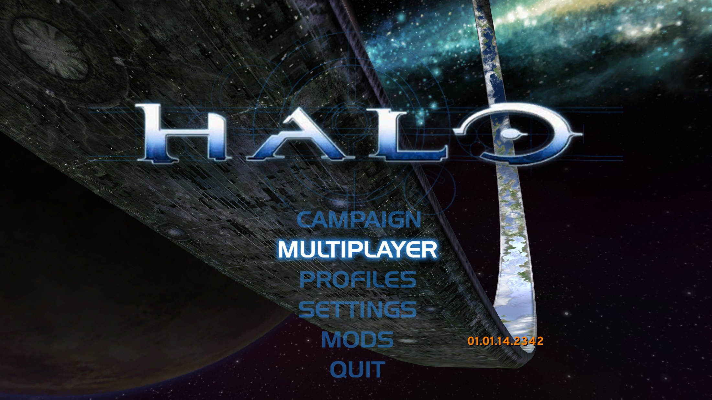
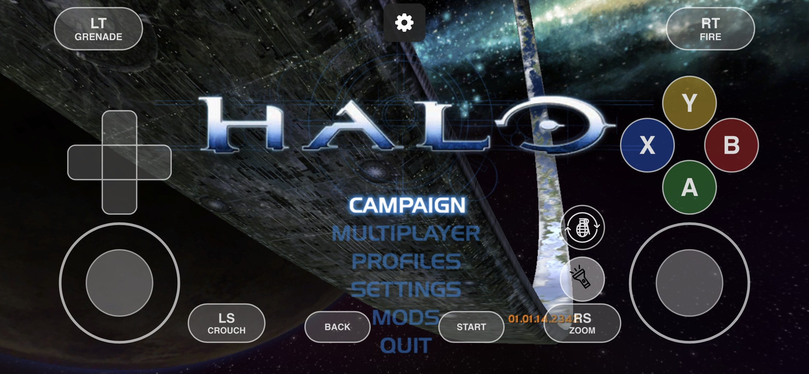
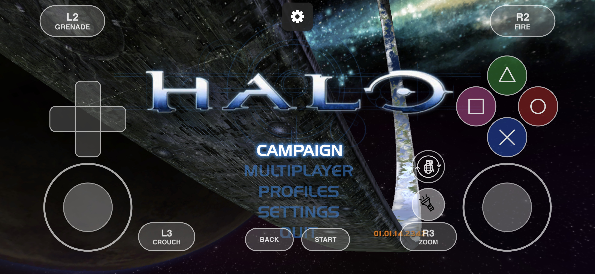
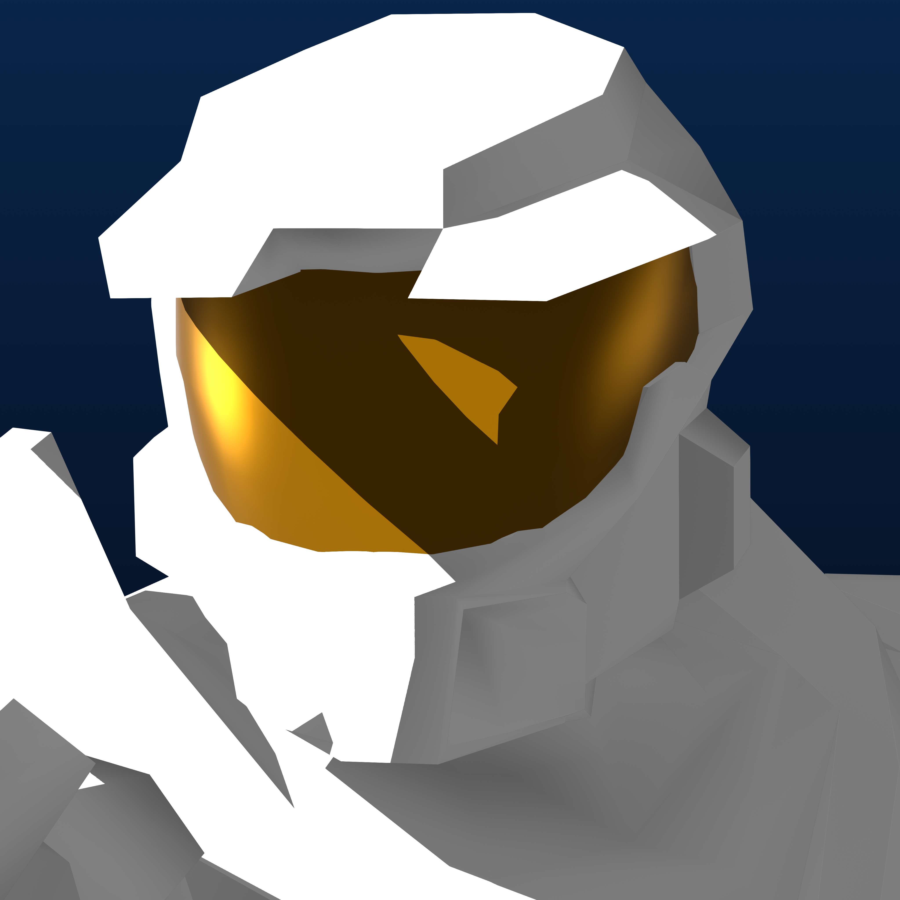

# Halo: Combat Evolved for iOS

A native iPhone and iPad port of *Halo: Combat Evolved*. It runs the recovered Xbox engine from
[OpenCE](https://github.com/OpenCommunityEdition/OpenCE) (formerly Halo CE Universal) inside a native iOS app, with touch and
controller support, cross-play multiplayer with OpenCE players, and a full in-app Settings menu.

> **One branch.** The regular app, Mod Test, and the Non-Jailbreak build are options on **Actions → Halo CE iOS — Build IPA**. There is no separate Mod Test branch.

> **Status: playable.** The regular app is playable on jailbroken devices, and the separate Non-Jailbreak build remains **in beta** (see [device test results](docs/ios/DEVICE_TESTS.md)). The current source update is **M2.6.123**, on OpenCE **build 335** (network version 41). This larger upstream jump needs CI, a Mac build and device validation before an IPA release. See the [release notes](docs/ios/RELEASE_NOTES.md) and [project status](IOS_PORT_STATUS.md).

## Current Status

> **Jailbroken devices:** the regular app is confirmed working on jailbroken iOS devices.
>
> **Non-jailbroken devices:** the **Non-Jailbreak Version (Beta)** (a separate option in **Actions → Halo CE iOS — Build IPA**) is confirmed working on one stock iPhone, an iPhone 14 Plus on iOS 16.2, sideloaded with Sideloadly using a normal account and no memory entitlements. It has been tested on that one device only and is a **beta**: expect glitches, bugs and occasional crashes. It is not yet broadly tested or officially supported.
>
> **Free-account sideloading (Sideloadly, AltStore, SideStore):** works on the tested device with the Non-Jailbreak Version. It needs the phone to be able to reserve one contiguous 4 GiB span of address space, and an iPhone 14 Plus on iOS 16.2 can do that only at a non-4-GiB-aligned address, which this build handles. An older iPad cannot reserve 4 GiB contiguously at all and is outside this design. Other iPhones are untested. See [Install](docs/ios/INSTALL.md#sideloading-with-free-and-paid-accounts).
>
> **Paid Apple Developer accounts:** people who have one may be able to sign the regular app with the `extended-virtual-addressing` and `increased-memory-limit` capabilities and get it to start on a non-jailbroken device. We have not tested this, and the project does not require or build around paid accounts. See [Install](docs/ios/INSTALL.md#sideloading-with-free-and-paid-accounts).

## Recent updates

**New:** [M2.6.108](port/ios/UPDATE_M2708.md) adds the voice chat microphone (Settings > Audio > Voice Chat > OPEN MIC) and works with AirPods and other headsets with a microphone.

**Fix:** [M2.6.107](port/ios/UPDATE_M2707.md) repairs M2.6.104-106: a startup failure (guest ABI mismatch, fixed in M2.6.106) and a freeze when joining an internet game. Do not use those builds.

**Update:** [M2.6.123](port/ios/UPDATE_M2723.md) moves to OpenCE **build 335** (network version 41) with upstream renderer, input, multiplayer and server-browser changes; older network-38 builds cannot cross-play. Mac and device validation are pending.

**Prior:** [M2.6.122](port/ios/UPDATE_M2722.md) moves to OpenCE **build 268** (network version 38), adding OpenCE gametype names to game listings and a per-player shield-effects option. Network-36 clients cannot cross-play with this build. [M2.6.121](port/ios/UPDATE_M2721.md) brought SWAT, Infection, Gun Game, Hardcore and Custom Edition HUD/texture work. [M2.6.120](port/ios/UPDATE_M2720.md) added the iOS Developer Console and mod-toggle synchronization. [M2.6.119](port/ios/UPDATE_M2719.md) brought build 246 and increased the memory window and texture cache. [M2.6.118](port/ios/UPDATE_M2718.md) integrated OpenCE build 244 / network 32 with the map-aware Custom Edition pickers. [M2.6.117](port/ios/UPDATE_M2717.md) added map-aware weapon and vehicle pickers; [M2.6.116](port/ios/UPDATE_M2716.md) added map-load recovery.

**Previous:** [M2.6.113](port/ios/UPDATE_M2713.md) moves to OpenCE **build 220** (same network version 29) and makes Settings > Mods the same list as the game's new Mods menu: mods turned on or off, reordered, removed or added in either place show in both.

**Earlier:** [M2.6.112](port/ios/UPDATE_M2712.md) adds Settings search, a Talk / Mute button on the touch controls, the voice chat microphone off by default and in sync with the game, a profile picker, emoji and photo Settings icons with favorites, and clearer Mods filters.

**Update:** [M2.6.110](port/ios/UPDATE_M2710.md) moves to OpenCE **build 211** (same network version 29) and turns **map sharing off by default** on iOS, with a switch in Settings > Multiplayer. Not yet run on a device.

**Source update:** [M2.6.109](port/ios/UPDATE_M2709.md) moves to OpenCE **build 206 / network 29**: a new network version (it cannot join build 201 or older hosts, nor they it). Custom Edition maps keep their own names (build 201 renamed them with a hash), map downloads are checked, and the changes are described in the update note. Not yet run on a device.

**Source update:** [M2.6.105](port/ios/UPDATE_M2705.md) moves to OpenCE **build 201 / network 28**: a new network version (it cannot join build 182 or older hosts), Custom Edition map sharing between players, shield glow and armor colors, first-person legs, and a web build that iOS does not use. [M2.6.104](port/ios/UPDATE_M2704.md) moved to OpenCE build 182 / network 25: a new network version (it cannot join build 154-167 hosts), Video Setup split into Graphics and FOV and Viewmodels screens, a viewmodel on/off switch, an elevator netcode fix and Android's on-screen controls (not used on iOS). [M2.6.103](port/ios/UPDATE_M2703.md) moved to OpenCE build 167 / network 24: netcode and sound-lifecycle fixes, correct transparent-surface ordering, a vote-kick switch on Server Setup and finer mouse-sensitivity steps. [M2.6.102](port/ios/UPDATE_M2702.md) brought OpenCE build 159 (voice chat with the Opus codec and player vote-kick); on iOS you can hear other players' voices, but the iPhone has no microphone path yet, so it cannot talk. [M2.6.101](port/ios/UPDATE_M2701.md) fixed the next Non-Jailbreak device crash (a frame-pointer chain walk in the HUD stack check) and records the Regular log after M2.6.100, which held about 60 FPS in gameplay. [M2.6.100](port/ios/UPDATE_M2700.md) was a Regular/Mod Test performance pass. A device log showed 16.2 million signal-bridge faults, 99.7% from the audio ADPCM decode loop, which reads guest memory through x30 (LLVM reuses the link register as a normal register). The aligned converter now translates x30 like any other base register, so those loads no longer fault. The Non-Jailbreak converter shares the same x30 handling from M2.6.99. Windows, Linux and Android stay on [OpenCE](https://github.com/OpenCommunityEdition/OpenCE/releases).

   
  <em>Main menu on PC (OpenCE)</em>

   
  <em>Main menu on iPhone — Xbox UI controls</em>

   
  <em>Main menu on iPhone — PlayStation UI controls</em>

## Highlights

- **Native app.** An `arm64` iOS app hosts the recovered `arm64_32` engine and draws with OpenGL ES 3. iOS and iPadOS 15 or later.
- **Touch controls.** Five named control schemes (Xbox and PlayStation styles), a drag-to-edit layout, touch look, floating sticks, left-handed
  layout, toggle crouch and zoom, gyro aiming and optional touch-aiming helpers. [Controls guide](docs/ios/CONTROLS.md)
- **Controller support.** Xbox, PlayStation and other controllers supported by Apple's GameController framework, with stick tuning and button remapping.
- **Multiplayer.** Crossplay with compatible OpenCE clients on other platforms: invite links, an invite file in iCloud Drive or the app's folder, a QR code,
  recent games, LAN games, and the public Server Browser, Direct Link and Create Game screens. [Multiplayer guide](docs/ios/MULTIPLAYER.md)
- **Display.** 30 FPS original, a 60 FPS target or uncapped; 4:3, widescreen or fullscreen; four render-resolution choices; a live HUD editor;
  first-person view options; AirPlay mirroring. [Display / AirPlay](docs/ios/DISPLAY_AIRPLAY.md), [Settings reference](docs/ios/SETTINGS.md)
- **Sound.** Native audio with separate Master, Music, Dialogue, Effects and Ambient volumes.
- **Campaign tools.** An optional, campaign-only Cheats menu organised into sections (survival, weapons, power-ups, movement, world,
  visuals, checkpoints, teleport, spawn), with a saved cheat recipe for each control scheme.
- **Backups and data management.** Separate Xbox and Custom Edition map libraries, optional user-supplied MP4 movie fallback, versioned backups you can export to Files or iCloud Drive, profile export and import,
  and diagnostics with a one-tap problem report. [Backups](docs/ios/BACKUPS.md)

## Quick start

**Prefer a visual walkthrough?** [Watch the iPhone setup video](docs/ios/videos/ipa-install-mod-loading.mp4) to see the IPA installed, a backup restored and Custom Edition maps loaded.

1. **Get the app.** Download `HaloCE.ipa` or `HaloCE-NonJailbreak.ipa` from the [M2.6.118 beta release](https://github.com/SnailBBQ/Halo-CE-IOS/releases/tag/v0.2.118-beta), or get an IPA from a successful [Actions run](https://github.com/SnailBBQ/Halo-CE-IOS/actions). You can also [build it yourself](docs/ios/BUILD.md).
2. **Install it.** The IPA must be re-signed and sideloaded onto your device. [Install guide](docs/ios/INSTALL.md)
3. **Add your game data.** The app does not include game maps. Import the Xbox `.map` files from your own copy of the game,
   including `ui.map`. [Game data guide](docs/ios/GAME_DATA.md)
4. **Play.** Open Halo CE, import your maps and start the game. Open the gear button at any time for Settings.

## Three apps from one project

| | **Halo CE** (regular) | **Halo CE Non-Jailbreak** (Beta) | **Halo CE Mod Test** |
| --- | --- | --- | --- |
| Purpose | The regular app, for jailbroken devices and TrollStore | For stock, sideloaded iPhones that are not jailbroken. **Beta: expect glitches, bugs and crashes** | A separate experiment that loads very large converted campaign maps |
| How to build | Actions → Build IPA, options off | Same workflow, tick **Non-Jailbreak** | Same workflow, tick **Mod Test** |
| Output | `HaloCE.ipa` (artifact `HaloCE-iOS`) | `HaloCE-NonJailbreak.ipa` (artifact `HaloCE-iOS-NonJailbreak`) | `HaloCE.ipa` (artifact `HaloCE-iOS-ModTest`) |
| Bundle ID | `com.haloceuniversal.ios.m0` | `com.haloceuniversal.ios.m0` (same as the regular app) | `com.haloceuniversal.ios.modtest` |
| Invite scheme | `halo://` | `halo://` | `halomodtest://` |

The three apps share the same features and are kept up to date together. The regular and Non-Jailbreak apps use the same bundle ID, so
install one or the other. Mod Test installs side by side with either and keeps separate data. See [Mod Test](docs/ios/MOD_TEST.md) for what
makes the third app different, and [Install](docs/ios/INSTALL.md#sideloading-with-free-and-paid-accounts) for the Non-Jailbreak app.

## Reporting a problem

Open an [issue](https://github.com/SnailBBQ/Halo-CE-IOS/issues/new/choose) and fill in the form. On the title screen tap **Logs** to get the
problem report, and paste it or attach it. Please include your iPhone model, iOS version, the app version (Settings > About) and which app you
use. Issues are public, so do not post anything private. The Non-Jailbreak build is a beta, so crash reports from it are especially useful.

## Documentation

| Guide | What it covers |
| --- | --- |
| [Install](docs/ios/INSTALL.md) | Requirements, getting the IPA, sideloading, first launch, updating |
| [Build the IPA](docs/ios/BUILD.md) | Building with GitHub Actions or on a Mac, build options, publishing a release |
| [Game data](docs/ios/GAME_DATA.md) | Importing maps, extracting maps from an Xbox ISO or XISO, where files live |
| [Backups](docs/ios/BACKUPS.md) | What a backup contains, exporting, restoring, recovery |
| [Settings reference](docs/ios/SETTINGS.md) | Every Settings screen and option |
| [Controls](docs/ios/CONTROLS.md) | Touch controls, controllers, gyro, touch aiming |
| [Multiplayer](docs/ios/MULTIPLAYER.md) | Invites, iCloud Drive and folder invite files, LAN, cross-play |
| [Display / AirPlay](docs/ios/DISPLAY_AIRPLAY.md) | Frame rate, picture shape and detail, the HUD editor, first-person view, heat and battery, menus, and showing the game on a TV |
| [Troubleshooting](docs/ios/TROUBLESHOOTING.md) | Safe Start, logs, problem reports, common problems |
| [Mods](docs/ios/MOD_FORMAT.md) | Adding mods to your iPhone, the load order, what a mod can replace, making your own |
| [Mod Test](docs/ios/MOD_TEST.md) | The separate Mod Test app |
| [Device test results](docs/ios/DEVICE_TESTS.md) | What has been tested on real devices |
| [Release notes](docs/ios/RELEASE_NOTES.md) | Every update, with its device checklist |
| [Official project and other platforms](docs/UPSTREAM.md) | OpenCE, its downloads and credits |

## Looking for the official project or other platforms?

This repository is an iOS-focused fork. The official project, its updates, and the Windows, Linux and Android versions
are maintained by **OpenCE**:

- Repository: <https://github.com/OpenCommunityEdition/OpenCE>
- Releases and downloads: <https://github.com/OpenCommunityEdition/OpenCE/releases>

[Official project and other platforms](docs/UPSTREAM.md) lists the downloads, where each platform is documented, and the credits.
The original README of the upstream project is kept in [docs/UPSTREAM_README.md](docs/UPSTREAM_README.md).

## Credits

This port exists because of the work of others:

- **[OpenCE](https://github.com/OpenCommunityEdition/OpenCE)** (formerly Halo CE Universal) and its contributors: the cross-platform port of the decompiled
  engine, its netcode and invite-link multiplayer, the Custom Edition style menus, and the project this app is built on.
- **[bnunu/halo-1](https://github.com/bnunu/halo-1)**, the decompilation of the Xbox build 2342 (`cachebeta.exe`) that OpenCE starts from,
  and **[punpckhdq/halo](https://github.com/punpckhdq/halo)**, the project it was forked from.
- **Bungie**, who created *Halo: Combat Evolved*, and **Microsoft / Xbox Game Studios** and **343 Industries**, its later owners and stewards.
- The open-source libraries bundled in [`port/third_party`](port/third_party): expat, extract-xiso, kcp, mbedtls, miniupnpc, Monocypher, musl math, stb and
  tomlc17, each under its own license.
- The iOS port in this repository is maintained by [SnailBBQ](https://github.com/SnailBBQ).

See [Official project and other platforms](docs/UPSTREAM.md#credits) for details.

### App Icon

  
    
  <strong>App icon artwork by ORION</strong> 
  <em>Used with ORION's permission. All credit goes to them.</em> 
  <a href="https://github.com/OrionMelaeno">GitHub</a> ·
  <a href="https://discord.com/users/758542539241685003">Discord</a>

## Legal

This is an unofficial, non-commercial fan project. It is not affiliated with or endorsed by Microsoft,
Xbox Game Studios, 343 Industries or Bungie. *Halo* and its name, characters and artwork are owned by Microsoft.

**No game files are included** (no maps, assets or original executable). You need your own copy of the game,
and you are responsible for using it in line with its license. We can't provide game files or help you find
them, so please don't share them, or links to them, here.

The engine is recovered from the original game by the upstream OpenCE project. This project claims no rights
held by Microsoft or anyone else.

This project is free software under the **GNU Affero General Public License, version 3 or (at your option) any later
version** ([LICENSE](LICENSE)), the license OpenCE moved to with build 246 (the source of earlier OpenCE builds stays under
[CC0 1.0](LICENSES/CC0-1.0.txt)). If you change the game and let others play with your version over a network, the AGPL
asks you to offer them your source (section 13); this repository is the source of the iOS app, and the app's Settings >
About links to it. That gives you no rights in *Halo*. Third-party libraries and fonts, the app icon by ORION, and the
screenshots in the docs keep their own terms (see the [credits](docs/UPSTREAM.md#credits)).

Builds are free and come with no warranty. If you share one, keep it free: no selling and no ads.

For maintainers, the [public release checklist](docs/ios/PUBLIC_RELEASE.md) records the remaining publication and verification steps.
