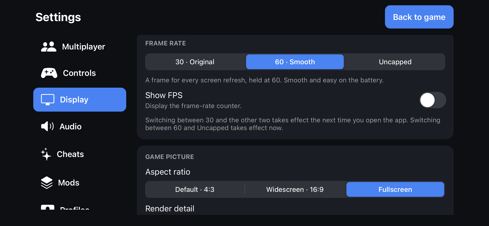

# Display / AirPlay

Picture, frame rate, HUD and mirroring options live in **Settings → Display**. Heat and battery controls are in **Settings → Advanced**. This page explains each option and ends with showing the game on a TV with AirPlay.

   
  <em>Settings → Display</em>

## At a glance

| Option | Choices | Applies |
| --- | --- | --- |
| [Frame rate](#frame-rate) | 30 · Original, 60 · Smooth, Uncapped; Show FPS | Between 30 and the others: next launch. Between 60 and Uncapped: at once |
| [Game picture](#game-picture) | Aspect ratio and Render resolution | Next launch |
| [Game HUD](#game-hud) | HUD profile and the live HUD editor | When you edit it |
| [First-person view](#first-person-view) | Both, Weapon, Hands, Hidden | At once |
| [HUD and text](#hud-and-text) | High-res HUD, High-res text | Next launch |
| [Heat and battery](#heat-and-battery) (Advanced) | Lower the frame rate when hot, Performance overlay | At once |
| [Menus](#menus) | PC menus (new) or Xbox menus | Next launch |
| [AirPlay](#airplay-and-external-displays) | System screen mirroring | n/a |

## Frame rate

- **30 · Original** runs the game at its original rate.
- **60 · Smooth** targets a maximum of 60 FPS. Actual performance depends on the device, scene, render detail and thermal state.
- **Uncapped** lets the game draw as fast as the phone can.
- **Show FPS** puts a frame counter on screen.

Moving between 30 and either of the others takes effect the next time you open the app. Moving between 60 and Uncapped takes effect now.

## Game picture

- **Aspect ratio:** **Default · 4:3** (the original 640×480 picture), **Widescreen · 16:9**, or **Fullscreen**, which follows your device's own shape. The game image is not stretched: the engine's own widescreen camera and viewport are used, and the original menus and HUD are centred.
- **Render resolution:** **480p**, **720p**, **960p** or **1080p**. Higher detail uses more GPU and memory and can lower the frame rate or warm the phone.

Both apply the next time you open the app. The default is 640×480, and [Safe Start](TROUBLESHOOTING.md#safe-start) always uses it.

## Game HUD

- **Game HUD profile** links the current control scheme to the default HUD or to one of three saved HUD recipes.
- **Edit game HUD** opens a live editor over the game. You can move, resize, fade or hide the FPS counter, the weapon HUD, health, shields and radar, navigation, and the damage indicators, one group at a time or all together, save three named recipes and reset a group or everything.
  The groups follow how the engine draws the HUD, so some text and special overlays may keep their original place.

## First-person view

Choose which first-person models are drawn: **Both**, **Weapon**, **Hands** or **Hidden**. It changes only the first-person drawing; the HUD, attacks and other players are not affected. If a weapon or the hands ever look wrong, try the other choices and report which one helps.

## HUD and text

**High-res HUD** and **High-res text** are the upstream options that draw the HUD and the menu and HUD text from higher-resolution assets. They apply the next time you open the app.

## Heat and battery

These controls are in **Advanced → Heat and battery**, immediately below Startup.

- **Lower the frame rate when the phone is hot.** Smooth 60 and Uncapped drop to 45 when iOS reports serious heat or Low Power Mode and to 30 when the phone is critically hot, and they return when it cools. **30 · Original** is never changed.
- **Performance overlay** adds, under the frame counter, how long a frame takes, the memory the app is using and estimated memory headroom (not a guaranteed termination threshold), and how hot the phone is.

## Menus

- **PC menus (new)** are the Halo Custom Edition menus from OpenCE: Join Game (LAN and Direct Link), Create Game for the Internet or your LAN, and redrawn screens. The public Server Browser lists compatible public Internet games using upstream’s signed lobby discovery.
- **Xbox menus** are the original menus, including System Link.

The choice applies the next time you open the app, and Safe Start always uses the Xbox menus. Navigate with the on-screen D-pad, A and B, or a controller.

## AirPlay and external displays

You can show the game on a TV or display with the system's **screen mirroring**.

1. Connect your iPhone or iPad to the same Wi-Fi network as the receiver (an Apple TV, an AirPlay-capable TV or a computer that accepts AirPlay), or attach a supported display adapter.
2. Open **Control Center** and choose **Screen Mirroring**, then pick your receiver.
3. Start or resume Halo CE. The game appears on both screens.

What to expect:

- **Mirroring, not a second window.** The whole screen is mirrored, including the touch controls. A separate game window on the TV with controls only on the phone is not implemented.
- **Hiding the controls.** Connect a controller and leave *Settings → Controls → Touch controls* on **Auto**, or choose **Hide**, to remove the touch buttons on both screens.
- **Picture shape.** For a 16:9 TV, choose **Widescreen · 16:9**. **Fullscreen** follows the phone's aspect ratio and may still leave borders on the TV. Set these under [Game picture](#game-picture). These apply the next time you open the app.
- **Cost.** Higher render detail uses more GPU and memory. Watch the frame rate and heat; the Performance overlay helps.
- **Quality and delay** depend on the receiver and your network. Mirroring has not been measured on a real receiver for this app yet.

If sound does not follow the display, check the AirPlay output in Control Center and try **Settings → Audio → Restart audio output**.

See the [Settings reference](SETTINGS.md#display) for the same options in table form.
