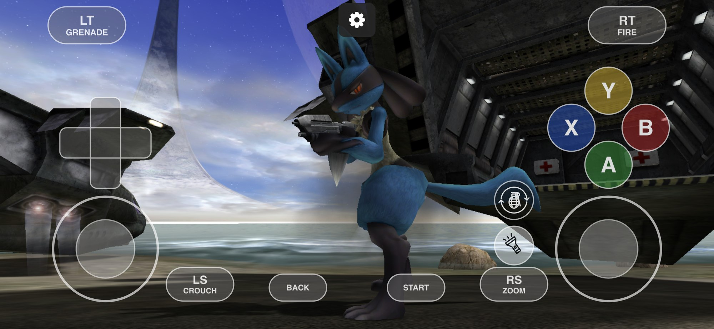

# Mods for Halo CE for iOS

A mod is a folder of Halo PC tag files that the game plays **over a map's own tags, on your iPhone only**, as a resource pack does: sounds (a
high-quality audio pack), bitmaps (a texture pack, a HUD redraw), text (a translation) and models (higher-detail weapons, vehicles, scenery,
or a new look for a character). Nothing of a mod is sent to another player, and a mod changes nothing that the players of a network game must
agree on, so you can play online with players who have other mods or none.

This guide is OpenCE's [Mods guide](https://github.com/OpenCommunityEdition/OpenCE/blob/main/docs/mods.md) (`docs/mods.md` in its sources),
adapted for the iPhone. The rules are the engine's and are the same on every platform. What differs is how a mod gets onto the phone and how you
manage it. Mods work in the regular app, in Non-Jailbreak and in Mod Test.

**Contents:** [Will this download work?](#will-this-download-work-start-here) · [Adding a mod](#adding-a-mod-to-your-iphone) ·
[Making a mod](#making-a-mod) · [Advanced reference](#a-mods-folder) · [Load order](#the-load-order-and-the-mods-list) ·
[What a mod can replace](#what-a-mod-can-replace) · [When something does not change](#when-something-does-not-change) · [Limits](#limits) ·
[Worked example](#worked-example-a-new-look-for-the-spartan)

## Will this download work? (start here)

Open the download and look inside for files ending in `.gbxmodel`, `.model`, `.bitmap`, `.sound`, `.unicode_string_list` or `.string_list`.

| What you find | Result |
| --- | --- |
| Only `.biped`, `.weapon`, `.vehicle`, `.scenario`, `.globals`, `.projectile`, `.effect` | **Does nothing.** These are never read, and a mod cannot add new characters, weapons or maps. |
| Textures, sounds or text that **replace** the game's own (same name as a stock tag) | **Works** once it has a `mod.toml`. |
| A model that replaces a stock one, with the same skeleton and markers | **Works.** If the skeleton differs, the game leaves the model out and the stock one plays. |
| A model for a **new** character or weapon (own skeleton, own animations) | **Does nothing as it is.** It has to be converted onto a stock model first. |

Quick test: a file only matters if the **same path exists in the game**, for example `tags/characters/cyborg/cyborg.gbxmodel`. A new name
(`characters/lucario/...`) is ignored.

## Adding a mod to your iPhone

1. **Unzip it first.** The app adds folders, not zip files. In the Files app, tap a `.zip` to unzip it.
2. Check that the folder you will add is the one that has **`mod.toml`** and a **`tags`** folder directly inside it. Downloads often wrap that
   folder in another one.
3. Open **Settings > Mods** and choose **Add a mod folder**. Pick the mod's folder (up to 32 at once). The app copies it into the mods folder
   and tells you if there is no `mod.toml`.

You can also copy a mod folder yourself, in the Files app, into **Halo CE > Halo > mods** (`Documents/Halo/mods`).

The mod is **on** as soon as it is added. A map that is running picks it up when you press OK in the game's Mods screen, or after Settings
changes it; otherwise it plays the next time a map loads. Settings > Mods and the game's own **Mods** screen (main menu) use one list: turning a
mod on or off in either menu updates the other. Settings refreshes its list while open.

## Making a mod

Start with the [MyMod template](mod-template/MyMod), then make a replacement for a tag the map already has:

1. Get the tag as a file with `invader-extract`, or start with the Halo Editing Kit's PC tags.
2. Change a supported tag such as a `.bitmap`, `.sound`, `.unicode_string_list` or compatible `.gbxmodel`.
3. Keep the tag's original name and put the file under `tags/` in your mod folder. Add a `mod.toml`.
4. In Halo CE, open **Settings > Mods > Add a mod folder**, choose the folder, and load a map.
5. If it does not appear, check the log and the [compatibility details](#what-a-mod-can-replace).

A mod replaces supported resources that a map already uses. It cannot add a new weapon, vehicle, character or map. The technical reference below explains which replacements are compatible.

<details>
<summary>Advanced reference: folders, load order, file formats and limits</summary>

## A mod's folder

```
mods/
  hd_audio/
    mod.toml
    tags/
      sound/sfx/weapons/assault rifle/fire.sound
      sound/dialog/...
  german/
    mod.toml
    tags/
      ui/hud/hud_item_messages.unicode_string_list
```

- **A file's path is the map tag's name plus its group's extension**, as the Halo Editing Kit and Invader keep them. The tag
  `characters\cyborg\bitmaps\cyborg` becomes `tags/characters/cyborg/bitmaps/cyborg.bitmap`. Names are not case-sensitive.
- The game only looks up the names of the map's tags among a mod's files: **a mod cannot add tags**, and no path can leave the mod's folder.
- A folder without `mod.toml` is not a mod. A starter is in `docs/ios/mod-template/MyMod`.

### mod.toml

It says what the mod is. **Every key is optional**, but the file must exist:

```toml
name = "High-res audio"       # what the Mods list shows (else the folder's name)
id = "hd_audio"               # what other mods name it by (else the folder's name)
version = "1.0"
authors = ["Someone", "Someone else"]   # or one string
description = "The game's sounds at 44 kHz"
maps = ["a10", "bloodgulch"]  # the maps it is for, by their file names (else every map)
load_after = ["hd_textures"]  # mods it plays over: they load before it
load_before = ["fixes"]       # mods that play over it: they load after it
incompatible = ["other_audio"]  # mods it cannot be played with
format = 1                    # the mods' format it is made for
channel_order = "pc"          # use "xbox" if bitmap channels are already in Xbox order
```

- `load_after`, `load_before` and `incompatible` name other mods by their `id` or folder name. A mod they name that is not installed is passed over.
  `maps = []` is every map.
- A mod made for a later `format` than the app's build, or whose `maps` names no map, is not played. Anything else wrong in `mod.toml` (an unknown
  key, a wrong type) is logged and the rest is used.
- `channel_order = "xbox"` keeps that mod's multipurpose-map and HUD-meter bitmap channels as supplied. Use it only when those bitmaps already have
  Xbox channel order; PC-format bitmaps use the default `"pc"`. Keep bitmaps of different channel orders in separate mods.

## The load order and the Mods list

Every mod is on until you turn it off. Mods load in an order, and where two mods have a file for the same tag, **the one loaded later plays**.

- The default order is the folders' names, alphabetical, except that a mod's `load_after` / `load_before` mods are moved to the side it asks for.
- In **Settings > Mods** (and the game's Mods screen) the mod at the **top** plays over all those below it. Each entry shows its version, authors,
  maps, description, priority (1 is the top) and any problem. Use **On / Off**, **Move up / Move down** and **Remove**.
- A warning sign means a mod is on the wrong side of a mod it asked to load before or after. A red cross means a mod that is on says it cannot be
  played with this one, or that it cannot be played at all (made for a later build, or its `maps` names none).
- The order and the mods turned off are kept in `mods/load_order.toml`, by folder name:

  ```toml
  order = ["german", "hd_audio", "hd_textures"]
  disabled = ["hd_textures"]
  ```

  A mod added later goes where the default order puts it, and is on.

**Mods that cannot be played together.** On a computer the game asks about them before it starts. The iPhone cannot show that question: the app
plays them all and shows the warning on the mod, so you can turn one off yourself.

The game's console commands (`mods_list`, `mods_reload`, `mods_enable`) can be entered from **Settings > Cheats > Developer Console**. For ordinary on/off changes, use either **Settings > Mods** or the game's **Mods** menu; both update the same list. To see the original game, turn the mods off in either menu.

## What a mod can replace

| Group | Extension | What it is |
| --- | --- | --- |
| Sound | `.sound` | Sounds, music and dialogue |
| Bitmap | `.bitmap` | Textures, sprites, the HUD's pictures |
| Unicode string list | `.unicode_string_list` | The text the game shows |
| String list | `.string_list` | Other text |
| Model | `.gbxmodel` (Halo PC's) or `.model` (the Xbox's) | What objects look like: weapons, first-person weapons and arms, vehicles, scenery, characters |

Everything else (`.weapon`, `.biped`, `.vehicle`, `.scenario`, `.globals`, animations, collision geometry) is **never read**: those decide what
every player's game must agree on. That is also why a mod cannot add a new character or weapon.

A file must be a Halo PC tag file of its group, as the Halo Editing Kit's tools and Invader write them (a model also as `invader-extract` writes an
Xbox map's `.model`). The game checks every count, size and offset in it, and every value against what the game reads, before it uses the file. **A
file that fails a check is left out and the map's own tag plays**; the rest of the mod still works.

### Sounds
- 16-bit PCM, Xbox ADPCM or Ogg Vorbis, mono or stereo, at 22 or 44 kHz. The game converts them to the Xbox ADPCM it plays.
- A sound must have permutations (a file with an empty pitch range is left out), and each permutation must fit one block of the sound cache.

### Bitmaps
- Types: 2D, 3D and cube maps. Formats: A8, Y8, AY8, A8Y8, R5G6B5, A1R5G5B5, A4R4G4B4, X8R8G8B8, A8R8G8B8, DXT1, DXT3, DXT5 and P8 bump. Sides are at
  most 4096 (512 for a 3D bitmap). A side that is not a power of two means the bitmap is drawn linear and must be an uncompressed 2D bitmap.
- **One bitmap's pixels may take at most about 5.5 MB on the iPhone** (a 2048 x 2048 DXT5 with its mipmaps fits).
- A bitmap replaces the map's bitmap of its name, and the map's other tags use it as the map's: it needs **at least as many bitmaps, of the same
  types, and as many sequences, each with at least as many sprites**. It can be larger: a redraw at twice the size is drawn at the map's size, sharper.
- The HUD draws a bitmap at its own size, so the game scales each HUD element by the ratio of your bitmap to the map's, when that ratio is the same
  for all of them. A HUD bitmap that is not the map's redrawn evenly is left out. The HUD's digits can be the map's size or twice it. Menus draw a
  bitmap in their widgets' bounds, whatever its size.

### Text
- A list keeps the map's number of strings (extra strings are left out; missing ones stay the map's).
- A string that is a format (`%s was killed by %s`) replaces the map's only if it has **the same conversions in the same order**. A translation keeps
  them. Unicode strings are UTF-16, as the tool writes them.
- The main menu is the port's own, whose text is in tags named `pc\...`. A mod's `ui\shell` lists change the Xbox menus' text and what shows while
  playing (HUD messages, multiplayer messages, the pause menu).

### Models
A model is more than what is drawn: its nodes (skeleton) are what animations move, its markers are where projectiles leave a weapon and where
things attach, and its regions and permutations are what damage and variants choose among. Players' games agree on those, so a mod's model must
keep the map's:

- the same nodes: names, hierarchy and default positions;
- the same markers: names, regions, permutations, nodes, positions and rotations;
- the same regions and permutations: names and flags.

Positions and rotations may differ by **0.001** at most. **Only what is drawn is yours:** the geometries, their parts and vertices, which geometry
each permutation draws at each detail level, the detail cutoffs, the base map's scale and which shader each part uses. Every shader must be one the
map already has (a mod cannot add tags); a bitmap mod can redraw the shader's picture.

- The model is checked against each map's own model of its name as the map loads. On a map whose model of that name has other nodes, markers or
  regions (a custom map's own assault rifle, say), or lacks a shader the mod names, the mod's model is left out there and the mod's other files
  still play. `maps` in `mod.toml` keeps a mod to the maps it is made for.
- Where a mod has both a `.gbxmodel` and a `.model`, the `.gbxmodel` plays.
- A part's links to the parts drawn before and after it must not go round. A model of 44 nodes or more is drawn a part's own nodes at a time, and a
  part's vertices may name 22 nodes at most.
- The collision geometry, animations and the object's tag are the map's, so a larger weapon still hits where the map's does, and a much larger model
  may vanish at the screen's edges.
- Do not use `shader_transparent_chicago_extended` (Gearbox added it for Halo PC; the Xbox game has none): use a `shader_transparent_chicago`.

## When something does not change

1. Open **Settings > Logs** and share the logs, or open `debug.txt`. Every file the game left out has a line starting `mods:` with the reason, and
   there is a summary of what each kind of tag plays from mods:

   ```
   mods: 354 bitmaps from their files (354 new), 0 given back, 6 left out
   mods: 313 sounds from their files (313 new), 0 given back, 2 left out
   mods: 4 models from their files (4 new), 0 given back, 1 left out
   ```
2. Check it is **on** in Settings > Mods, that nothing above it replaces the same file, and that the mod's `maps` line (if any) names your map.
3. Check the path: the same name as the map's tag, forward slashes, the group's extension.
4. On a model, the usual reasons are a different skeleton, missing markers, or a shader the map does not have.

## Limits

256 mods, folder names of 63 bytes at most, 262,144 files in all, 24 folders deep under `tags`, 64 maps in a mod's `maps`, and up to 32 folders added at
once. The mods' tags keep at most **192 MB** in memory on the iPhone (their files, sounds' samples, bitmaps and models' geometry), so a very large
pack may have files left out; the log says so. A Custom Edition map takes mods as an Xbox map does.

</details>

## Worked example: a new look for the Spartan

<p align="center">
  <br>
  <em>Example of a compatible Lucario model replacement running in-game. The mod files are not included.</em>
</p>

A community download of a "Lucario" biped is a new biped. A mod cannot add a biped, so nothing changed. The working version replaces the Spartan's
own model instead:

1. Its mesh was moved onto the Chief's skeleton (the original used a different arm pose).
2. The Chief's eight markers (weapon, flashlight, hands, feet) were added.
3. All five textures were packed into one 1024 x 1024 picture that replaces `characters\cyborg\bitmaps\cyborg`, with the mesh's UVs moved to match.
4. A neutral picture replaces `characters\cyborg\bitmaps\cyborg multipurpose` so the Chief's team tint and shine do not touch it.

Every player then looks like Lucario **on your phone only**, and team colors are gone.

## More

The engine's own guide, with the same rules for every platform, is
[`docs/mods.md` in OpenCE](https://github.com/OpenCommunityEdition/OpenCE/blob/main/docs/mods.md). The code is in `port/linux/game/mods.c`,
`mod_sounds.c`, `mod_bitmaps.c`, `mod_strings.c`, `mod_models.c` and `port/linux/src/port_mods.c`; the iPhone's Settings > Mods list is in
`port/ios/HaloIOS/HaloMods.m`.

## A halomaps.org map shows a blue screen

Most maps from halomaps.org are Custom Edition maps that share the pictures and sounds of the Custom Edition game instead of carrying their own. Those files are `bitmaps.map`, `sounds.map` and `loc.map`, and they come from a Halo Custom Edition (PC) install. Add them with **Settings > Mods > Import Custom Edition maps…** (the "Shared files" row shows which of the three the app has). Until they are there, such a map cannot load and the game shows a blue screen; the log says "a map needs a resource map that was not supplied". A map that carries everything it needs loads without them.
