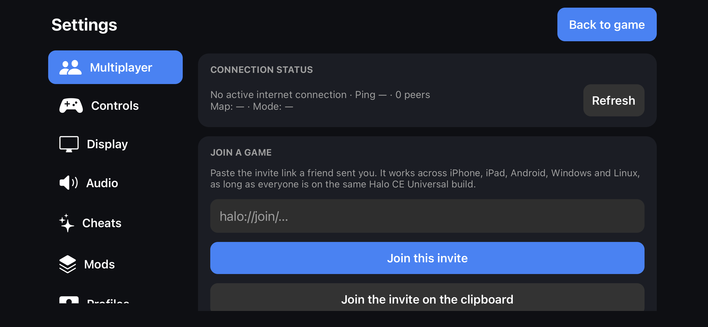

# Multiplayer

The game can play system link games on a local network and over the internet, and this app can host and join them.

- Upstream supports up to 128 players on 128 machines. That ceiling has not been load-tested on iOS; it is not a recommended phone-host capacity.
- **Cross-play.** The protocol is shared with OpenCE on Windows, Linux and Android. Device testing reported here covers iPhone-to-PC play; the other combinations still need testing.
- **No dedicated game server is needed** for an invite game. Connection setup uses public signalling brokers and STUN infrastructure, then attempts a direct connection between players. Network restrictions can prevent that connection.
- The netcode is new: each machine moves its own player immediately, and the host decides the game. The
  [upstream netcode notes](https://github.com/OpenCommunityEdition/OpenCE/blob/main/port/linux/NETCODE.md) describe it.

## Compatibility

For reliable cross-play, use matching tested OpenCE builds and compatible map content. The network protocol and content must be compatible; the app version alone does not prove compatibility. Keep every player’s OpenCE installation updated together. If you use mods or custom maps,
keep every player on matching content. Settings → Advanced → About shows the version of the app and the game build it was made from.

The two apps use separate invite schemes: the regular app opens `halo://` links and the [Mod Test app](MOD_TEST.md) opens `halomodtest://` links.

   
  <em>Settings → Multiplayer</em>

## Joining a game

| Way | How |
| --- | --- |
| Invite link | In **Settings → Multiplayer**, paste a `halo://join/` link (or just its 64-character hexadecimal code) into **Join this invite**, or use **Join the invite on the clipboard**. Tapping a `halo://` link in another app also joins. |
| Clipboard automatically | Turn on *Join links on the clipboard automatically*. It is off by default because iOS may request permission when the clipboard is read. Opening a link does not need it. |
| iCloud Drive | Choose an iCloud Drive folder and paste an invite shared by any player into `game_invite.txt`, then press **Join from game_invite.txt**. See [Alternate way of using invite codes: iCloud Drive](#alternate-way-of-using-invite-codes-icloud-drive). |
| Recent games | **Join again** reuses a game you hosted or joined. It only works while that game is still running. |
| LAN | Games on the same Wi-Fi appear in the LAN list. Allow **Local Network** for Halo CE in iOS Settings. |
| In-game Menus | **Join Game → Direct Link** accepts manual invites; use native Settings to paste or read an invite file on iOS. Discord-client integration is not available on iOS. **Join Game → LAN** lists local games. **Join Game → Server Browser** lists compatible public Internet games; Refresh and Join use upstream’s invite system. |

## Hosting a game

Start a game from **Create Game** in the menus: **Internet** for a game friends can join by invite, or **LAN** for your local network (the Xbox menus call this System Link).
While you host:

- Your invite is shown in **Settings → Multiplayer → Host a game**, ready to share.
- It is written to **game_invite.txt** (see below).
- **Invite QR code** shows it as a code that someone next to you can scan with their camera.

Ending hosting clears this app's owned invite export. A stopped lobby cannot be joined, but M2.6.50 may reuse the same token when hosting resumes within the same app session. Do not treat an old token as permanently revoked.

## Public discovery update

**Source update:** M2.6.100 remains on OpenCE build 155, whose network version is **24** (the same as build 154; build 146 was 22). Lobby listings and joins are filtered by that number, so an iPhone and a PC can only see or join each other when both run compatible OpenCE network-version-24 builds and matching maps. Build 155 keeps the missing-map reporting and Custom Edition map support from build 146 and, per its documentation, also checks a joiner's Custom Edition map version against the host's. These changes are integrated in source and still need current-build iOS device/cross-play validation. M2.6.67 added the earlier build 101 lobby, split-screen and broker changes described next.

M2.6.67 integrated OpenCE build 101. It includes upstream multiplayer split-screen lobby join/leave handling and adding local players before joining an in-progress match and loads signalling brokers from a packaged `brokers.txt` beside config.toml. The default list is refreshed at launch; choose another filename with `network.brokers_file` for a custom list. The retired `network.signalling_brokers` string is no longer used.

Public discovery depends on an active public host and reachable upstream brokers; it does not list every stock Halo PC or MCC server. iOS exposes two local input slots: touch plus one controller or two controllers. Upstream desktop support for four local players does not imply four-controller support in this iOS host. Build 98 cross-platform and local-player join/leave behavior still need device testing.

## Alternate way of using invite codes: iCloud Drive

`game_invite.txt` holds the invite of the game you are hosting.

1. In **Settings → Multiplayer**, choose **Choose iCloud Drive folder** and pick iCloud Drive or a folder inside it. The app remembers the folder and writes the file there. Until you choose one,
   the file is in the app's own `Documents/Halo` folder.
2. When you host, the app writes the current invite into the file.
3. To join any player’s game, paste their invite into the same file, wait for iCloud to sync, and press **Join from game_invite.txt**. It reads the file once when you press the button and never joins by itself.

Ending a game, or the next launch, clears the file only if it still holds the code this app wrote, so an invite you pasted from another player is kept. The file holds a single link of at most 1,024 bytes.
iCloud syncs eventually, and a force-quit app may clean up on its next launch. If access stops working, choose the folder again.

## Connection status

The status row shows whether you are hosting, joined or connecting, the tunnel round-trip time when there is one (LAN-only games may have none), the connected peers, the current map and the mode.
A peer count is not a player count. It refreshes every two seconds while Settings is open.

## Good to know

- All cheats are switched off when you host or join a game.
- **Crossplay with other platforms** works best when all players use compatible OpenCE builds and matching maps.
- Smooth, stable play depends on the phone: see [Display → Heat and battery](SETTINGS.md#display) and the [troubleshooting](TROUBLESHOOTING.md) page if a game drops.

## Public Internet games

With PC menus selected, open **Multiplayer → Join Game → Server Browser**. The list shows compatible public games with map, mode and occupancy. Refresh it and select a game to join without copying an invite. It uses the same invite transport as Direct Link.

In **Create Game → Internet → Server Setup**, **LISTING** selects PUBLIC or PRIVATE. Upstream defaults new Internet games to PUBLIC; LAN games are never publicly listed. `network.host_public = false` in the engine config changes that default, and `network.public_lobby = false` disables discovery. Xbox menus retain their existing System Link flow; public setup and browsing are provided by the PC menus.

Listings are signed by the host, periodically refreshed and expired; closing a lobby publishes its end. Making a public game private rotates its invite, and iOS updates Settings, sharing and `game_invite.txt` to the replacement code. Private games remain available through manual invites. All players should use compatible Universal clients; older or incompatible listings are filtered.

The browser depends on upstream’s public MQTT brokers. An empty list may mean no compatible public games, blocked/unavailable brokers, or no Internet connection. It is not evidence that a local game failed. Verify public iPhone/PC hosting and joining on devices before treating discovery as tested on iOS.

## Local Network permission

If Halo CE is missing from iOS Settings → Privacy & Security → Local Network, open Settings → Multiplayer → Finding games on your Wi-Fi and select **Request Local Network access** while connected to Wi-Fi. This runs a Bonjour permission check; it does not replace the game's UDP discovery. Accept the system request, then try the in-game LAN list. The app name may differ for ModTest. You can also open the app's iOS settings from that card.

Permission alone does not guarantee discovery: guest-network isolation, firewalls and broadcast/multicast signing restrictions can prevent LAN traffic. If discovery remains unavailable, use a compatible invite link. Verify LAN discovery with the final signed IPA on a physical device.

## Build 89 integration

With the PC-style menus, the multiplayer pause menu now offers Settings; the host also gets End Game, which finishes the match and keeps players for the next game. Opening these menus does not pause the network clock. Enemy name labels obey the motion tracker’s range and player-filter rules. Unarmed melee and grenades remain disabled from vehicle seats. These upstream changes need validation with iOS and build 94 clients.

Local Network access can be checked in Settings → Multiplayer. The diagnostic publishes and browses a temporary Bonjour service, reporting success or the actual error. A missing iOS privacy entry is not evidence that permission is granted. UDP broadcast discovery also depends on signing with Apple’s multicast entitlement; ordinary sideloading may not provide it. Manual invites remain available when LAN discovery is unavailable.

## Local campaign co-op

Universal build 95 adds two-player split-screen campaign play on one device. Choose Multiplayer → Co-op Campaign. Connect one controller for player two while player one uses touch, or connect two controllers before entering co-op. Select player two’s profile using their controller. This is local campaign play, separate from online multiplayer invites and the public server browser. See [M2.6.57](../../port/ios/UPDATE_M2657.md) for setup and testing.
