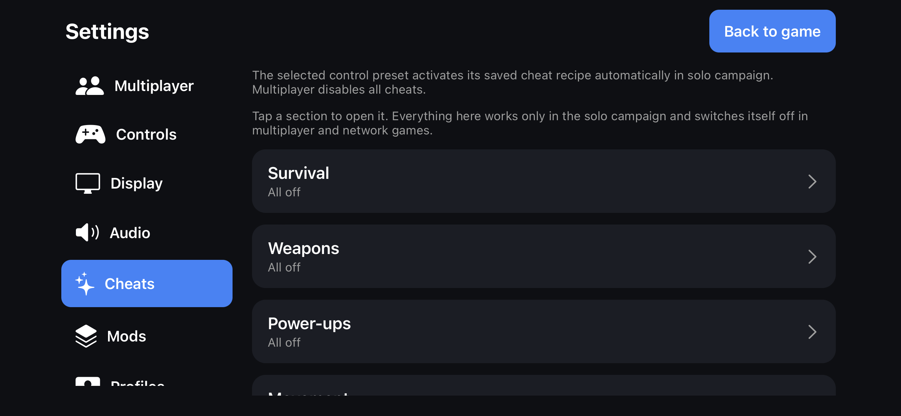

# Settings reference

Open Settings with the **gear button** that floats over the game. Hold the gear for about a third of a second, then drag to move it; it stays inside the
safe area and above the game controls. Settings has a category list on the left and a **Logs** entry pinned at the bottom.

Some options take effect at once. Others, marked *next launch*, are read when the app opens. A **Safe Start** after a failed launch temporarily
switches off the riskier options (see [Advanced](#advanced)).

## Contents

[Multiplayer](#multiplayer) · [Controls](#controls) · [Display](#display) · [Audio](#audio) · [Cheats](#cheats) · [Mods](#mods) ·
[Profiles](#profiles) · [Options](#options) · [Advanced](#advanced) · [Logs](#logs)

## Multiplayer

See the [Multiplayer guide](MULTIPLAYER.md) for how each part works.

| Item | What it does |
| --- | --- |
| Connection status | Whether you are hosting, joined or connecting, the tunnel ping, connected peers, the current map and mode. Refreshes every two seconds. |
| Join this invite / Join the invite on the clipboard | Join a `halo://join/` link, or the bare 64-character hexadecimal code. |
| Alternate way of using invite codes: iCloud Drive | Choose an iCloud Drive folder for `game_invite.txt`, paste a compatible invite shared by any player, and press **Join from game_invite.txt**. |
| Host a game | Shows your current invite, which is also written to the invite file, and lets you share it or show a QR code. |
| Join links on the clipboard automatically | Off by default, because iOS may request permission when the clipboard is read. Opening a `halo://` link joins without it. |
| Finding games on your Wi-Fi | Help for LAN discovery and the Local Network permission. |
| Invite QR code | Appears while you host. |
| Recent games | The last eight games you hosted or joined, with **Join again**, a QR code, and **Clear recent games**. |

## Controls

See the [Controls guide](CONTROLS.md) for details. Most options here are **saved separately for each of the five control schemes**.

| Card | Options |
| --- | --- |
| On-screen controls | Touch controls **Auto / Always show / Hide** (global); rename the scheme; **Edit button layout…**; reset the scheme to the Xbox layout. |
| Control scheme | The scheme's name and face-button style (Xbox or PlayStation), and its campaign cheat recipe (see [Cheats](#cheats)). |
| Looking | Drag to look, look speed, look acceleration, invert look. |
| Touch aiming | Auto-fire on enemies, aim with the Fire button, fire with the right stick (all off by default). |
| Sticks | Floating sticks, dead zone, move stick response. |
| Buttons | Button opacity and haptic feedback. |
| Layout and latching | Left-handed layout, toggle crouch, toggle zoom. |
| Gyro aiming | Aim by turning the device; speed; flip left/right and up/down. |
| Controller (global) | Stick dead zone and response for a connected controller, and a button remap list. |
| Game HUD preset | Link the scheme to the default HUD or to one of three saved HUD recipes. |
| On app launch | **Start Halo CE iOS Title Screen** or **Boot Halo to Main Menu** (direct boot). |

## Display

Each option is explained, with a screenshot, in [Display / AirPlay](DISPLAY_AIRPLAY.md).

| Card | Options |
| --- | --- |
| Frame rate | **30 · Original**, **60 · Smooth** (targets a maximum of 60 FPS when the device keeps up) or **Uncapped**. **Show FPS** shows a counter. Moving between 30 and the others applies *next launch*; between 60 and Uncapped, immediately. |
| Game picture | **Aspect ratio**: Default · 4:3, Widescreen · 16:9 or Fullscreen (the device's own shape). **Render resolution**: 480p, 720p, 960p or 1080p. Both apply *next launch*. Default stays 640×480, and Safe Start always uses it. Higher detail uses more GPU and memory. |
| Game HUD | Choose the default HUD or a saved recipe for the current scheme. **Edit game HUD** opens a live editor over the game for the FPS counter, weapon HUD, health/shields/radar, navigation and damage indicators. Position, scale, opacity and visibility can be changed per group or all together. Three named recipes can be saved. |
| First-person view | **Both**, **Weapon**, **Hands** or **Hidden**: which first-person models are drawn. Applies at once and does not affect the HUD, attacks or other players. |
| HUD and text | **High-res HUD** and **High-res text**, the upstream options for crisper HUD and menu text. *Next launch*. |
| Menus | **PC menus (new)**: the Halo Custom Edition menus from OpenCE, with Join Game (LAN and Direct Link), Create Game (Internet or LAN) and redrawn screens. **Xbox menus**: the original menus, including System Link. *Next launch*; Safe Start uses the Xbox menus. |
| AirPlay and external screens | How to show the game on a TV. See [Display / AirPlay](DISPLAY_AIRPLAY.md#airplay-and-external-displays). |

The public **Server Browser** in the in-game PC-style menus lists compatible public Internet games through upstream’s signalling brokers. Refresh and select a lobby to join using the existing invite connection path. iOS device validation is pending.

## Audio

| Item | What it does |
| --- | --- |
| Sound | Turns game sound on or off. |
| Master volume | Overall output level. |
| Music, Dialogue, Effects | Separate levels, applied to each engine sound class before mixing. |
| Ambient volume | The environment: water, wind, machinery and computer hum, devices and doors. |
| Restart audio output | Stops and starts the audio engine without touching the game. Try it if sound cuts out or crackles after a call, headphones or Bluetooth changes. |

Bink videos are skipped. Engine-rendered cinematics play normally.

## Cheats

**Cheats work in the solo campaign only.** They switch off by themselves in multiplayer and network games. You can open the sections at any time to read
them, but their controls are disabled outside a solo campaign. **Running cheats are never saved:** they clear when you relaunch, leave the campaign, or host
or join a game. Cheats that spawn things use only assets the current map has already loaded; if one is missing, the app says so.

   
  <em>Settings → Cheats</em>

| Section | Contents |
| --- | --- |
| Survival | God mode; One-hit kills (hostile units only); No fall damage; **Restore health and shield** (a one-time refill; an over-charged shield is never lowered). |
| Weapons | Infinite ammo; Infinite grenades; Bottomless clip (no reloading); Rapid fire; No recoil; Drop Weapon Ring Around Player (the map’s cheat weapon collection); Projectile Swapping (loaded tags only, local player only). |
| Power-ups | **Active Camo** and **Overshield**, each with *Infinite* (refreshes only the living local player and stops when switched off), *Spawn* and *Apply*. Applied camo uses the normal pickup timer. Applied overshield charges once and is consumed by damage; it has no universal expiry timer. |
| Movement | Jetpack; Noclip (aim to move, jump rises, crouch descends); Super jump (1–10); Player speed (1–5); Low Gravity (25% of the current gravity, restored when switched off). |
| World | Time scale (10%, 25%, 50%, 75%, 100%, 150%, 200% or 300%, including cutscenes); AI ignores you; Third person; Unlimited flashlight; Medusa Mode (hostile AI detecting you die); Bumper Cars (hijack an AI-driven vehicle on contact); Hijack NPCs (possess living non-player bipeds on contact); Infinite Vehicle Health (occupied vehicle only); AI Alliance (Human, Covenant, Flood or Sentinel); Erase All AI (encounter AI, with confirmation). |
| Visuals | Vertical FOV (0 is the normal setting, otherwise 20–90 degrees); Wireframe Render (bounded triangle-edge visualization); Detach Camera from Player (flying camera; body frozen, world continues; on foot, outside scripted cameras). |
| Checkpoints | **Save checkpoint (when safe)** waits up to eight seconds for a moment without combat; **Force checkpoint now** saves at once; **Revert to last checkpoint** asks first and needs a checkpoint to exist. These are the game's own checkpoints. |
| Teleport | **Teleport To Camera** (engine validates destination); **Teleport me to crosshair**; **Teleport enemies to crosshair** (living hostile AI units not in vehicles, up to 24, placed in a ring); three **Saved positions** to save and return to (forgotten when the mission changes). |
| Spawn | **Weapon giver** (pistol, assault rifle, shotgun, sniper rifle, rocket launcher, plasma pistol, plasma rifle, needler, flamethrower, gravity rifle) and **Vehicle spawner** (Warthog, Ghost, Banshee, Scorpion). Pickups appear in front of you. |

**Cheat recipes.** Each control scheme has a gear editor with its own recipe: the cheats to switch on, one-shot actions, numeric values, slow motion and a weapon.
Recipes are saved with the scheme and applied when you enter a solo campaign or choose another scheme during one; each one-shot action runs once.

## Mods

**Mods** is the map library.

- **Installed game files.** *Show installed game files* is off by default because the list is long. When shown, campaign maps come first in mission order,
  then the multiplayer maps in the game's own menu order (or alphabetically with *Sort multiplayer maps A–Z*), then other maps, then `ui.map`.
  *Multiplayer only* hides the campaign maps. Each card shows a picture, name, type, size and a header check. Pictures can be taken from `ui.map`
  or chosen by you.
- **Mods.** Import compiled Xbox map files through Files. Imported mods start **switched off**. Switch them on, and reorder them: a later map replaces an earlier one with the same file name.
  Changes apply on the next launch, before the engine starts, never to a running map. Original maps are kept and restored when their replacements are switched off.
  Files are checked for an Xbox version-5 header, a sensible size and an import hash.
- Only compiled maps work. Loose editor tags, PC-format maps and executable plugins do not. Keep everyone in a multiplayer game on the same content.

## Profiles

Three kinds of data are kept separate:

- **App settings profile:** control schemes, layouts, cheat recipes, HUD, display, audio, shortcuts and colours. Exported as `.haloprofile`; active cheats and Halo saves are excluded.
- **Halo player profile:** in-game name, multiplayer armor color, controller preferences and campaign completion records. Create/select a named profile in-game, then edit it here. Built-in default profiles do not persist edits.
- **Campaign save:** checkpoint progress for that player. Multiplayer uses player profiles and game variants, not campaign checkpoints.

- **What a profile holds** shows a summary.
- **Import / export campaign saves** and **Import / export Halo player profiles** open separate `.halobackup` workflows with only that category selected. Restore creates a recovery backup first and takes effect next launch. A fresh install may also need the matching Halo player profile. See [Backups](BACKUPS.md).
- **Halo controller settings** synchronize look sensitivity, look/flight inversion, auto-center, button/stick layouts, vibration and in-game help with the active player profile. Vibration requires compatible controller hardware.
- **Network setup** shares Internet play, UPnP, clipboard joining and player-name visibility with the in-game menu. Reopen the network session after changing connection options. The desktop self-updater does not install iOS IPAs.
- **Edit campaign checkpoint** edits validated finite health, shields, grenade counts and existing weapon ammo directly in a saved checkpoint. Changes apply on the next launch with recovery backups; see [Backups](BACKUPS.md#campaign-checkpoint-editor).
- **Export profile…** saves a `.haloprofile` file for Files, AirDrop or sharing. **Import profile…** replaces your settings with a file's, so export first if you want to keep yours.
- **Reset all settings to defaults** restores everything after a confirmation. Maps, saves and mods are not touched.

## Options

| Item | What it does |
| --- | --- |
| Settings button | Size from 75% to 175%, and a reset for its size and position. The touch target is never smaller than 44 points. |
| Hide / show shortcut | Defaults to Up, Up, Down, Down, Left, Right, Left, Right, B, A. Set a 1–16 button sequence, maximum gap (0.25–10 seconds) and total duration (1–60 seconds), or leave it empty to disable. Inputs still reach the game. Three-finger double-tap restores the icon, as does relaunching. Hidden state is session-only. |
| Icon appearance | Opacity from 15% to 100%; gear, sliders, controller, grid or an image from Files (up to 8 MB and 2048 pixels per side). A small PNG copy is included in preference backups; `.haloprofile` alone does not embed the image. |
| Accent color | Blue, Green, Purple, Amber or Rose for Settings buttons, switches, sliders and selections. Gameplay colours are separate. |
| Custom color | Any colour from the colour wheel or a hex value such as `#3385FA`. Very dark or very light colours are adjusted slightly so text stays readable. |
| Chroma (RGB) mode | The accent colour cycles through the spectrum while Settings is open, with a cycle time of 3 to 60 seconds. |

## Advanced

| Item | What it does |
| --- | --- |
| Quit Game | Closes the app after a confirmation. iOS cannot reopen an app by itself, so tap its icon to start again. |
| Startup | **Start Halo CE iOS Title Screen** or **Boot Halo to Main Menu**, saved with the current control scheme. |
| Heat and battery | **Lower the frame rate when the phone is hot**: Smooth 60 and Uncapped drop to 45 under serious heat or Low Power Mode and to 30 when critical, and return when the phone cools (30 · Original is never changed). **Performance overlay** adds frame time, memory in use, estimated memory headroom, and heat under the FPS counter. |
| Diagnostics | **Performance profiler** adds timing diagnostics. |
| Share log files / Report a problem… | Share the logs, or make one text file with your device, settings (never running cheats) and the end of the logs. See [Troubleshooting](TROUBLESHOOTING.md). |
| Safe Start | Appears when the last start did not finish. Sound, internet play, smooth 60 FPS, hi-res HUD and text, the profiler, the PC menus and the picture options are disabled for that launch. Running for 15 seconds after the first frame marks the launch as successful; normal options return on the next launch. **Leave safe mode** makes the next start normal. |
| Backups | **Manage backups**. See [Backups](BACKUPS.md). |
| About | App version and the OpenCE build the game is based on. |
| Credits | A link to this project on GitHub. Full credits are in the [README](../../README.md#credits). |

## Logs

**Logs** opens Diagnostics with a **Summary** (including memory) and a **Problems** tab. Logs can be shared from here and from Advanced.

## Release preparation: settings organization

The sidebar ends with Cheats, Profiles, Options, Mods, Advanced and Logs. Display groups the Game HUD preset selector and editor in one card, and places AirPlay and external screens last. Heat and battery controls are in Advanced immediately below Startup. Render resolution offers 480p, 720p, 960p and 1080p; 480p remains the default and changes apply on the next launch. Resolution describes vertical pixels; width follows the selected aspect ratio.

The performance overlay shares the FPS layout's saved position, scale, visibility and opacity. Its memory headroom is an estimate, not an iOS termination threshold. Apple builds and device validation are required for these changes.

In Controls → Edit Button Layout, drag the FPS/performance overlay directly. **FPS / Stats** opens its existing scale, opacity and visibility controls. These edits share the saved FPS layout.

Detached camera uses the flying camera’s sticks, with RT/LT (R2/L2) to rise/descend. The player’s previous suspension state is restored when detachment ends, and the temporary body freeze is removed before a checkpoint is written. Projectile changes affect newly created local-player shots and keep the original projectile if the selected tag is missing. Faster time and world/AI cheats can disrupt mission scripts; revert a checkpoint to recover. Infinite Vehicle Boost and Force Skull Modifiers are not exposed because this recovered engine has no validated matching systems.

### Cheat shortcuts and control tuning (M2.6.62)

Each shortcut has a cheat selector, a button sequence and gap/total time limits.
Tap the touch-button grid or select Record gamepad buttons and press your controller.
Save commits the changes; Cancel discards them. An empty sequence disables the shortcut.
Controller input is withheld from gameplay while the editor is open. Cheat shortcuts
operate only in solo campaign. Module headers list active cheat names.

Controls are grouped into Touch Controls, Gamepad Controls and Halo Controller Settings.
Gamepad tuning is applied immediately to held stick positions without generating button presses.
Gyro yaw follows the direction of the device by default; both inversion switches remain available.

Weapon Giver is in Weapons, before Projectile Swapping. Its grenade buttons refill frag
or plasma grenades once to the current map's normal capacity. Drop Weapon Ring follows
Projectile Swapping. Spawn contains vehicles only. All Equipment Spawns has been removed
from the app's UI and action dispatch; old bindings to that action are disabled.
